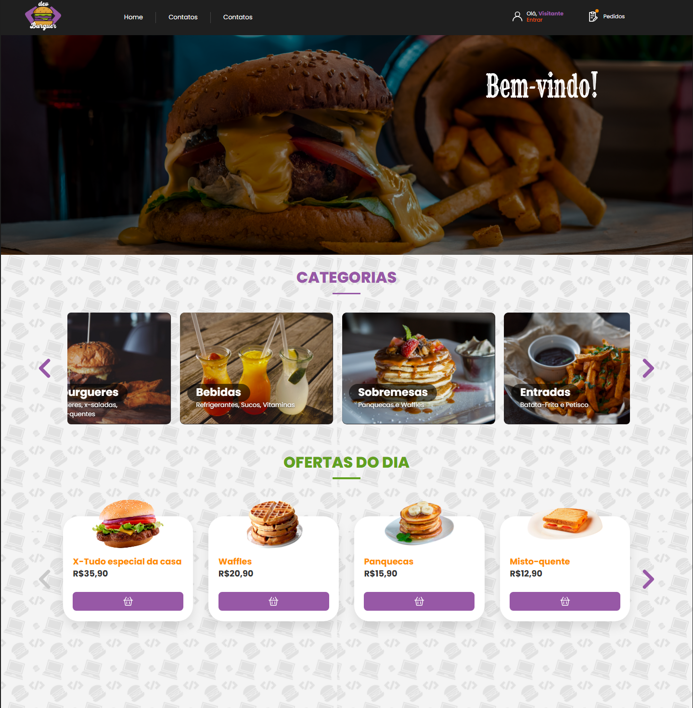

# Home do Codeburguer

A rota `/` reproduz a referência fornecida com banner, categorias e quatro ofertas. O texto `HOME_CARROSSEL` e os favoritos não aparecem na referência final e foram removidos. A largura máxima é 1440 px; as fotos mantêm suas proporções e nunca ultrapassam suas dimensões nativas. O CSS é isolado em `.dev-burguer-app` para preservar as telas de autenticação.

## Organização

- `src/pages/Home.jsx`: conecta a home ao `AuthContext` e à rota `/login`.
- `src/features/home/HomePage.jsx`: composição da página e estado dos diálogos.
- `src/features/home/components/`: cabeçalho, banner, carrosséis, cards e diálogos acessíveis.
- `src/features/home/data/catalog.js`: categorias, textos, preços em centavos e importações das imagens.
- `src/features/home/hooks/`: cesta persistente, notificações e navegação do carrossel.
- `src/features/home/lib/`: validação da cesta, limites e formatação monetária.
- `src/features/home/styles/`: CSS e fontes locais.
- `src/features/home/assets/images/`: nove fotos originais fornecidas, sem redimensionamento dos arquivos.

## Imagens e marca

O cabeçalho reutiliza `src/assets/devburger-logo.png`, original transparente de 2977 × 2757 px já presente no projeto. O fundo reutiliza `src/assets/home/catalog-transparent-pattern.svg`, fornecido pelo usuário e já existente no repositório. O SVG incorpora sua imagem e sua opacidade de 15%; não se deve aplicar opacidade adicional no CSS.

| Imagem | Dimensões nativas |
| --- | --- |
| Banner | 2880 × 914 |
| Hambúrgueres, bebidas e sobremesas | 319 × 232 cada |
| Entradas | 265 × 232 |
| X-Tudo | 314 × 223 |
| Waffles | 164 × 117 |
| Panquecas | 166 × 118 |
| Misto-quente | 188 × 107 |

Poppins e Rye estão em `assets/fonts/`, com as respectivas licenças OFL. A home usa fontes e imagens locais. As fontes externas anteriormente usadas nas telas de autenticação permanecem configuradas em `src/index.css`.

## Comportamento e integração

O cabeçalho mostra o primeiro nome do usuário autenticado, chama o logout existente e envia visitantes à tela de login. As rotas de cadastro, serviços de autenticação e backend permanecem preservados.

Os carrosséis funcionam com mouse e teclado. Os diálogos nativos aceitam Escape, mantêm o foco dentro deles e o devolvem ao controle que os abriu. A cesta salva quantidades no navegador, descarta dados inválidos e limita cada item a 99 unidades. Valores são calculados em centavos inteiros.

O catálogo continua estático. A cesta não envia pedidos à API. Os dois links “Contatos” seguem a referência; os dados reais de contato ainda precisam ser cadastrados. A home não simula usuários autenticados.

## Validação

Na pasta `frontend`:

```sh
npm ci
npm test
npm run build
npx playwright install chromium
npm run test:e2e
```

Os testes cobrem dados inválidos na cesta, limites, valores, persistência, carrosséis, diálogos, login/cadastro/logout e ausência de ampliação/overflow em 320, 375, 1440 e 1920 px.


